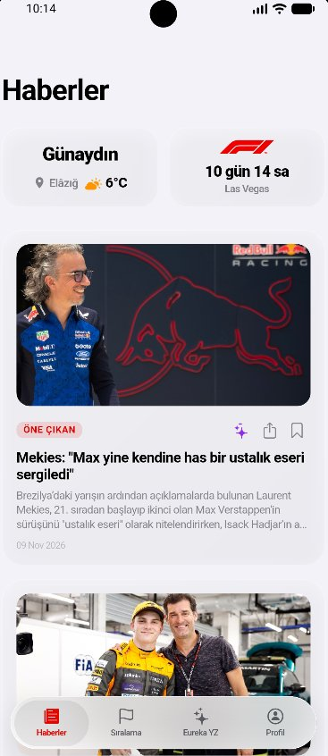
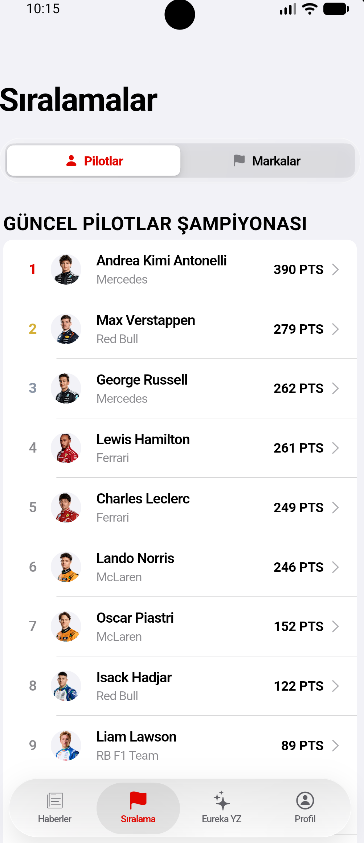
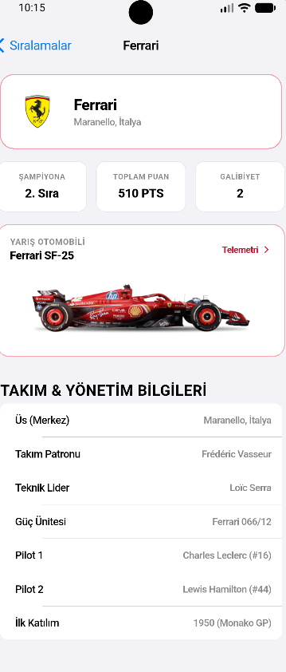
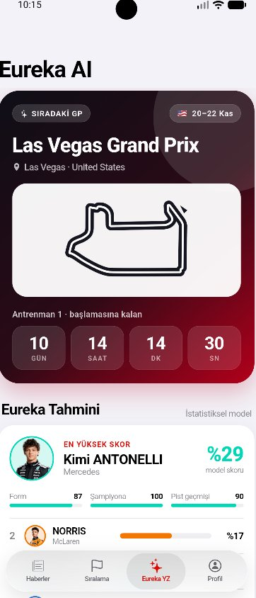

# 🏎️ Eureka — Yapay Zeka Destekli Formula 1 Haber, Canlı Telemetri ve Yarış Analiz Platformu


> **Akademik Proje Bildirimi:**  
> Bu yazılım projesi, **Fırat Üniversitesi** bünyesinde yürütülen **Lisans Bitirme Projesi** kapsamında tasarlanmış ve geliştirilmiştir. Uygulama; gerçek zamanlı spor telemetrisi, RSS tabanlı içerik agregasyonu, istatistiksel tahminleme algoritmaları ve üretken yapay zeka (*Generative AI*) modellerinin modern mobil yazılım mimarisiyle bütünleştirilmesini amaçlamaktadır.

---

## 📱 Uygulama Ekran Görüntüleri

<p align="center">
  <table>
    <tr>
      <td align="center">
        <br/>
        <b>1. Haberler & Akıllı Özet</b><br/>
        <sub>Anlık hava durumu, yarış geri sayımı, RSS manşetleri ve tek dokunuşla Gemini AI haber özeti</sub>
      </td>
      <td align="center">
        <br/>
        <b>2. Şampiyona Sıralamaları</b><br/>
        <sub>Güncel Pilotlar ve Markalar (Takımlar) Şampiyonası puan durumu</sub>
      </td>
      <td align="center">
        <br/>
        <b>3. Takım & Araç Telemetrisi</b><br/>
        <sub>Takım yönetimi, teknik şasi verileri ve canlı OpenF1 sensör telemetrisi</sub>
      </td>
      <td align="center">
        <br/>
        <b>4. Eureka AI Yarış Analizi</b><br/>
        <sub>Sıradaki GP geri sayımı, istatistiksel kazanma olasılığı modeli ve yapay zeka strateji yorumu</sub>
      </td>
    </tr>
  </table>
</p>

---

## 🎯 Proje Hakkında

**Eureka**, Formula 1 ve motor sporları takipçileri için **iOS Cupertino "Liquid Glass" (Sıvı Cam)** tasarım prensipleriyle geliştirilmiş çapraz platformlu (*iOS & Android*) bir mobil uygulamadır. Uygulama; güncel motor sporları haberlerini, canlı şampiyona verilerini, araç sensör telemetrilerini ve **Google Gemini + OpenF1** tabanlı istatistiksel yarış analizlerini tek bir arayüz altında birleştirir.

### Temel Özellikler

- **📰 Haber Akışı, Şehir Bazlı RSS ve Yapay Zeka Özetleme:**
  - Güncel Formula 1 haberlerinin XML/RSS ayrıştırma motoru ile çekilmesi ve uygulama içi okuma modunda (*Reader View* & *WebView*) sunulması.
  - Her haber kartı üzerinde yer alan yapay zeka butonu (`✨`) aracılığıyla **Google Gemini 1.5 Flash** modeli üzerinden haberin *"Öne Çıkan"*, *"Puan/Yarış Etkisi"* ve *"Son Durum"* başlıklarında 3 maddelik anlık özetinin çıkarılması.
  - Kullanıcının bulunduğu şehre göre otomatik yerel haber akışlarının (`CityRssService`) yüklenmesi ve özel RSS kaynaklarının eklenebilmesi.
- **🏆 Pilotlar & Markalar Şampiyonası ve Canlı Telemetri:**
  - Jolpica (Ergast) F1 API ve OpenF1 API verilerinin paralel olarak birleştirilmesiyle güncel pilot ve takım puan durumlarının listelenmesi.
  - Pilot ve takım detay sayfalarında yarış otomobili teknik özelliklerinin (*Güç ünitesi, monokok şasi, şanzıman*) ve OpenF1 sensör yolu üzerinden **Zirve Hız (km/h)**, **Motor Devri (RPM)**, **Vites**, **Gaz Oranı (%)** ve **DRS** durumunun gösterilmesi.
- **🤖 Eureka AI — İstatistiksel Yarış Tahmin Modeli ve Teknik Analiz:**
  - Pilotların son 3 yarıştaki ağırlıklı form grafiği, güncel şampiyona puan oranı ve ilgili pistteki geçmiş yıl performanslarını birleştiren matematiksel model (*Softmax olasılık dağılımı*) ile kazanma/podyum olasılıklarının hesaplanması.
  - Gerçek OpenF1 verileriyle (lastik hamuru *stint* stratejileri, pist ve hava sıcaklıkları, son yarış podyumu) beslenen **Google Gemini 2.5 Flash** entegrasyonu sayesinde halüsinasyondan arındırılmış teknik strateji ve risk analizlerinin üretilmesi.
- **📍 Pist Navigasyonu ve Mesafe Hesaplama:**
  - Takvimdeki Formula 1 pistlerinin coğrafi koordinatları ile kullanıcının konumu arasındaki kuş uçuşu mesafenin hesaplanması ve **Apple Haritalar / Google Maps** üzerinden yol tarifi oluşturulması.

---

## 🔒 Veri Gizliliği ve Uygulama İzinleri Politikası

**Eureka** uygulaması, kullanıcı mahremiyetini ve veri güvenliğini temel öncelik olarak kabul eder. Uygulama kapsamında talep edilen cihaz izinleri, kullanım amaçları ve veri işleme ilkeleri aşağıda resmi olarak beyan edilmiştir:

### 1. Kullanılan Cihaz İzinleri ve Amaçları

| İzin Türü | Teknik Tanım (Android / iOS) | Kullanım Amacı ve Kapsamı |
| :--- | :--- | :--- |
| **Konum İzni** | `ACCESS_COARSE_LOCATION`<br/>`ACCESS_FINE_LOCATION`<br/>`NSLocationWhenInUseUsageDescription` | Yalnızca uygulama açıkken (*When In Use*) üç işlev için kullanılır:<br/>1. Bulunulan şehrin anlık hava durumu bilgisini (`OpenWeatherMap`) göstermek.<br/>2. Bulunulan ile ait yerel RSS haber kaynaklarını (`CityRssService`) listelemek.<br/>3. Kullanıcının mevcut konumundan Formula 1 pistlerine olan kuş uçuşu mesafeyi (`Geolocator`) hesaplamak ve harita navigasyonu başlatmak. |
| **İnternet ve Ağ Erişimi** | `android.permission.INTERNET` | RSS haber kaynakları, OpenF1 telemetri servisi, Jolpica/Ergast şampiyona verileri ve Google Gemini yapay zeka API uç noktaları ile güvenli (`HTTPS`) veri iletişimi sağlamak amacıyla kullanılır. |
| **Harici Uygulama / Bağlantı Açma** | `url_launcher` / `queries` | Haberlerin orijinal kaynaklarını tarayıcıda görüntülemek ve kullanıcının talebi doğrultusunda harici harita uygulamalarını (*Google Maps, Apple Haritalar*) başlatmak için kullanılır. |

### 2. Veri Gizliliği, Güvenlik ve Saklama İlkeleri

1. **Konum Verilerinin İşlenmesi:** Cihazdan alınan GPS koordinatları yalnızca çalışma zamanında (*runtime*) anlık hesaplama ve hava durumu sorgusu için kullanılır; **hiçbir uzak veritabanında depolanmaz, geçmişe dönük takip edilmez ve reklam/analitik ağlarıyla paylaşılmaz.** Konum izni verilmemesi durumunda uygulama varsayılan konum (Elâzığ) ile kesintisiz çalışmaya devam eder.
2. **Kişisel Verilerin Korunması:** Uygulama, kullanıcılardan zorunlu kimlik bilgisi, rehber, kamera, mikrofon veya medya galerisi erişimi talep etmez.
3. **Yerel Depolama (`SharedPreferences`):** Kullanıcının manuel olarak eklediği özel RSS haber kaynakları yalnızca cihazın kendi yerel hafızasında saklanır ve uygulama silindiğinde cihazdan tamamen temizlenir.
4. **API Anahtarı Güvenliği (`flutter_dotenv`):** Dış servis anahtarları (`GEMINI_API_KEY`, `OPENWEATHER_API_KEY`) kaynak kod içerisine gömülmemiş olup `.env` ortam değişkenleri üzerinden izole edilmiştir.

---

## 🛠️ Teknoloji Yığını ve Mimari

- **Çatı & Dil:** Flutter SDK & Dart (`^3.13.5`)
- **Arayüz Tasarımı:** iOS Cupertino Design System & Özel *Liquid Glass* (`BackdropFilter` + Bulanıklık Katmanları)
- **Yapay Zeka Servisleri:** Google Gemini REST API (`gemini-1.5-flash` & `gemini-2.5-flash`)
- **Spor & Telemetri API'leri:** OpenF1 API v1 (İstek Kuyruklama + 10 dk Önbellek Mekanizması), Jolpica (Ergast) F1 API
- **Hava Durumu & Konum:** OpenWeatherMap API, `geolocator` (`^14.1.2`)
- **Ağ, Veri ve Depolama:** `http` (`^1.2.2`), `xml` (`^6.5.0`), `shared_preferences` (`^2.5.6`), `flutter_dotenv` (`^6.0.1`), `webview_flutter` (`^4.14.1`), `url_launcher` (`^6.3.0`), `share_plus`

### Proje Dizin Yapısı

```text
lib/
├── main.dart                          # Uygulama giriş noktası ve MainTabScaffold
├── core/theme/ios_theme.dart          # Cupertino tema ve tipografi yapılandırması
├── models/news_model.dart             # Haber veri modeli
├── services/                          # API, RSS, Hava Durumu ve Yapay Zeka servis katmanı
│   ├── city_rss_service.dart
│   ├── dashboard_service.dart
│   ├── gemini_service.dart
│   ├── rss_service.dart
│   └── standings_service.dart
├── widgets/                           # Özel Liquid Glass bileşenleri ve alt navigasyon barı
│   ├── ios27_switch.dart
│   ├── ios_glass_dialog.dart
│   ├── liquid_bottom_bar.dart
│   └── liquid_glass_list.dart
└── views/                             # Uygulama ekranları (Haberler, Sıralama, Eureka YZ, Profil)
    ├── ai/
    ├── news/
    ├── profile/
    └── standings/
```

---

## 🚀 Kurulum ve Çalıştırma

1. **Projeyi klonlayın:**
   ```bash
   git clone https://github.com/kullanici-adiniz/eureka.git
   cd eureka
   ```

2. **Ortam değişkenlerini (`.env`) yapılandırın:**
   Proje kök dizininde `.env` adlı bir dosya oluşturun ve API anahtarlarınızı tanımlayın:
   ```env
   GEMINI_API_KEY=gemini_api_anahtariniz
   OPENWEATHER_API_KEY=openweather_api_anahtariniz
   ```

3. **Bağımlılıkları yükleyin:**
   ```bash
   flutter pub get
   ```

4. **Uygulamayı çalıştırın veya Release APK üretin:**
   ```bash
   # Geliştirme modunda çalıştırmak için:
   flutter run

   # Release APK çıktısı almak için:
   flutter build apk --release
   ```

---

<p align="center">
  <sub><b>Fırat Üniversitesi — Lisans Bitirme Projesi</b> kapsamında geliştirilmiştir.</sub>
</p>
